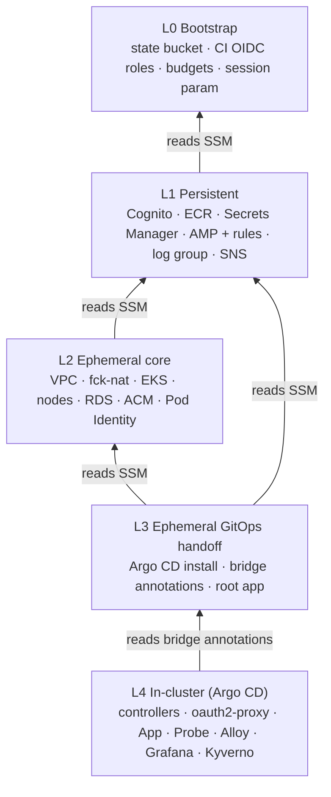
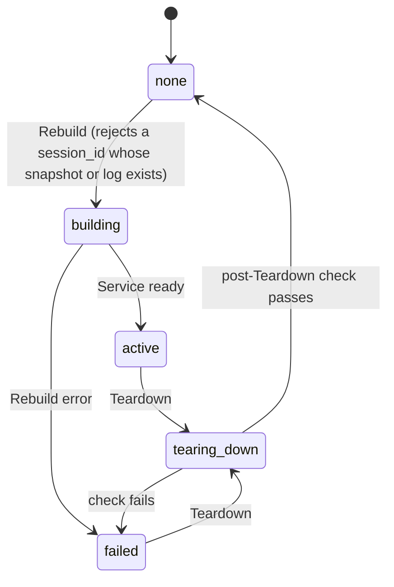
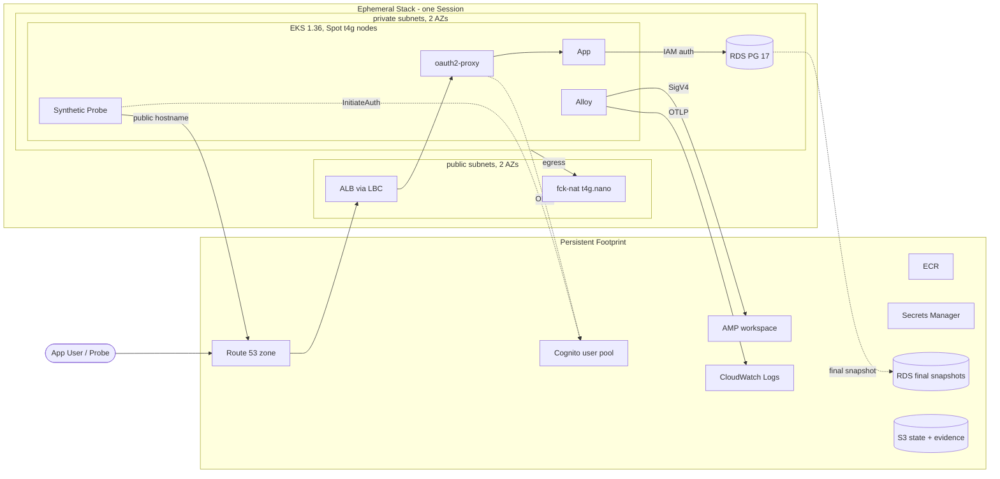

# Architecture Spine — Kubernetes-on-AWS

Vocabulary follows PRD §3 (Persistent Footprint, Ephemeral Stack, Session, Rebuild, Teardown, Drill, Synthetic Probe).

## Design Paradigm

**Layered stacks, one-way dependencies.** The platform has five layers. Each layer is created and destroyed as a unit. A layer may read from the layers below it, never from a layer above. Teardown walks the layers top-down, and Rebuild walks them bottom-up.

**Pull-based GitOps inside the cluster.** Terraform stops at the cluster boundary and hands over to Argo CD, which reconciles everything in the cluster from Git. A deploy, a rollback and an injected fault all reach the platform as Git commits.

| Layer | Lifetime | Owner | Lives in |
| --- | --- | --- | --- |
| L0 Bootstrap | permanent | Terraform, applied by a human | `infra/bootstrap/` |
| L1 Persistent | permanent | Terraform, applied by CI | `infra/persistent/` |
| L2 Ephemeral core | Session | Terraform, applied by CI | `infra/ephemeral/core/` |
| L3 Ephemeral GitOps handoff | Session | Terraform, applied by CI | `infra/ephemeral/gitops/` |
| L4 In-cluster | Session | Argo CD | `gitops/` |

## Invariants & Rules



Arrows point from the reader to the layer it depends on. No arrow points upward.

### AD-1 — Layered stacks with one-way dependencies

- **Binds:** all infrastructure code (FR-1, FR-12, FR-20, FR-31, NFR-3)
- **Prevents:** a lower layer depending on an upper one, which creates a cycle that blocks Teardown or makes Persistent resources depend on Ephemeral ones.
- **Rule:**
  - Every resource belongs to exactly one layer, L0 to L4.
  - A layer reads only from layers below it.
  - Anything that survives Teardown lives in L0 or L1. Nothing in L2 to L4 survives Teardown.

### AD-2 — Terraform roots and state

- **Binds:** `infra/*`, pipeline (FR-1, FR-12)
- **Prevents:** Kubernetes or Helm providers wired to a cluster created in the same root (which breaks destroy), persistent and ephemeral resources sharing state, and lock-table drift.
- **Rule:**
  - There are exactly four roots: `infra/bootstrap`, `infra/persistent`, `infra/ephemeral/core` and `infra/ephemeral/gitops`.
  - Each root has its own key in the single S3 state bucket: `<root-path>/terraform.tfstate`.
  - Locking uses S3 native locking (`use_lockfile = true`), with no DynamoDB table.
  - Kubernetes and Helm providers appear only in `infra/ephemeral/gitops`.
  - Shared code goes in `infra/modules/`. A root never calls another root.

### AD-3 — Cross-root handoff through SSM Parameter Store

- **Binds:** all four roots, plus the pipeline
- **Prevents:** implicit coupling through `terraform_remote_state` (which grants read access to the whole state), and hard-coded ARNs or IDs that go stale on every Rebuild.
- **Rule:**
  - A root exposes a value upward only by writing an SSM parameter named `/k8s-on-aws/<bootstrap|persistent|core|session>/<name>`.
  - Readers use the `aws_ssm_parameter` data source. The pipeline reads the same parameters.
  - `terraform_remote_state` is forbidden.

### AD-4 — Terraform/Argo CD boundary (GitOps Bridge)

- **Binds:** L2, L3, L4 (FR-9, FR-13, FR-14)
- **Prevents:** two owners for one resource, and per-Rebuild or account-specific values being hard-coded in Git.
- **Rule:**
  - **Ownership:** Terraform owns every AWS-side resource, including controller IAM roles and Pod Identity associations (AD-21). Argo CD owns every Kubernetes object. The only exception is that L3 installs Argo CD and the root app-of-apps.
  - **Where values come from:** L3 publishes values to L4 only as annotations on the Argo CD in-cluster cluster Secret. This set of annotations is closed: `cluster_name` (constant `k8s-on-aws`), `region`, `account_id`, `vpc_id`, `session_id`, `phase`, `domain`, `app_hostname`, `cert_arn`, `cognito_issuer`, `oauth2_client_id`, `probe_client_id`, `amp_remote_write_url`, `amp_query_url`, `log_group`, `rds_endpoint`, `rds_master_secret_arn`.
  - **How L4 consumes them:** ApplicationSets template their Helm values only from these annotations. Adding a new value means amending this AD.
  - **Git stays clean:** CI rejects AWS account IDs and `arn:` literals under `gitops/`.
  - **Repo access:** the repo is public, so Argo CD reads it over anonymous HTTPS with no repo credential.
  - **No side channels:** there is no `kubectl apply`, and no Terraform `kubernetes_*` resources outside L3.

### AD-5 — The Session state machine gates every ephemeral change

- **Binds:** all workflows (FR-12, FR-20, FR-30, NFR-1)
- **Prevents:**
  - a merge-triggered apply that rebuilds the cluster outside a Session or races a Teardown
  - a Rebuild that runs over a half-destroyed Session
  - final-snapshot names that change on every plan
- **Rule:** `/k8s-on-aws/session/state` (created in L0, with `ignore_changes` on its value) holds `none`, `building`, `active`, `tearing-down` or `failed`. `/k8s-on-aws/session/id` holds the current `session_id`.



  - Only `rebuild` and `teardown` write the state. `ephemeral-apply` (on merge) applies only in `active`.
  - In any other state, CI does a full plan of L2, `validate` only for L3, and render plus lint for `gitops/`.
  - Every workflow that touches L2 to L4 shares one concurrency group, `ephemeral`, with `cancel-in-progress: false`.
  - An alert-only watchdog emails the Operator if the state has been `active` for more than 4 hours (NFR-1).

### AD-6 — Tagging is the Teardown contract

- **Binds:** every AWS resource, including the ones controllers create (FR-31, NFR-1)
- **Prevents:** a resource created by a controller escaping the post-Teardown check, and artifacts that outlive the Session failing that check.
- **Rule:**
  - **Tags:** every resource carries `Project=k8s-on-aws` and `Layer=bootstrap|persistent|ephemeral`. Ephemeral resources also carry `Session=<session_id>`.
  - **How tags are applied:** Terraform uses `default_tags`. The LBC uses `--default-tags`, with values taken from the bridge annotations.
  - **Survivors of a Session:**
    - RDS uses `copy_tags_to_snapshot = false`.
    - Teardown tags the final snapshot and the retained automated backup `Layer=persistent`.
    - There are no per-Session KMS keys: EKS uses its default envelope encryption and RDS uses the `aws/rds` key.
  - **The check:** the post-Teardown check runs:
    - a Tagging API query for `Layer=ephemeral`
    - a sweep of billable resource types (EC2, EBS, ELBv2, EIP and public IPv4, RDS instances, ENI) against `scripts/teardown-check/allowlist.yaml`

    It confirms every hit with the service's own describe call, ignores resources pending deletion, and retries before failing loudly.

### AD-7 — Teardown order is fixed and runs through Git-shaped state

- **Binds:** Teardown workflow, ApplicationSets (FR-16, FR-31)
- **Prevents:**
  - Argo CD self-heal re-creating what Teardown deletes
  - a hung VPC destroy
  - orphaned load balancers and DNS records
  - a missing final snapshot
- **Rule:**
  - The workflow changes the cluster only by re-applying L3 with a new `phase` annotation. It never mutates the cluster with `kubectl` or `argocd`.
  - The ApplicationSets for workloads and the Gateway select `phase=active`. Setting `phase=draining` makes Argo CD delete them in cascade, while controllers are still running.

```mermaid
sequenceDiagram
  participant W as Teardown workflow
  participant T as Terraform
  participant A as Argo CD
  participant C as LBC + ExternalDNS
  W->>W: state = tearing-down
  W->>T: apply L3 with phase=draining
  A->>A: delete App, Probe, oauth2-proxy, Gateway (cascade)
  C-->>W: ALB gone + app records gone (polled)
  W->>T: destroy L3 (Argo CD only; controllers die with the cluster)
  W->>T: destroy L2 (RDS final snapshot k8s-on-aws-final-{session_id})
  W->>W: retag survivors, prune snapshots + backups (AD-9)
  W->>W: write Rebuild Log (AD-25)
  W->>W: post-Teardown check (AD-6)
  W->>W: state = none
```

### AD-8 — The cluster is stateless

- **Binds:** all L4 workloads
- **Prevents:** orphaned EBS volumes, and state silently lost at Teardown.
- **Rule:**
  - There are no PersistentVolumeClaims, and the EBS CSI driver is not installed.
  - Durable state lives only in RDS, AMP, CloudWatch Logs, S3 (the state bucket and `evidence/`) and Git.

### AD-9 — RDS lifecycle

- **Binds:** L2 RDS, Rebuild and Teardown (FR-16, FR-22)
- **Prevents:**
  - perpetual diffs or RDS replacement in the middle of a Session
  - a failed first Rebuild
  - Rebuild and Teardown disagreeing on which snapshot to use
  - surviving backups quietly running up cost
- **Rule:**
  - The final snapshot is named `k8s-on-aws-final-<session_id>`.
  - Rebuild (not Terraform) finds the newest final snapshot and passes it to L2 as `restore_snapshot_id`. An empty value means a fresh database. Setting `restore_mode=pitr` restores from the retained automated backup instead (FR-22).
  - `snapshot_identifier` is under `ignore_changes`.
  - Automated backups have 1-day retention and `delete_automated_backups = false`.
  - Teardown keeps the 5 newest final snapshots and the newest retained backup, and deletes the rest.
  - The RDS restore and the EKS cluster creation have no Terraform dependency between them, so they run in parallel (NFR-5).

### AD-10 — Database identity and schema

- **Binds:** App, L2 RDS, L4 Jobs (FR-10, FR-15, FR-16)
- **Prevents:** a static database password, migrations racing role creation, and a password nobody can read after a restore.
- **Rule:**
  - **Master credential:** the master password is RDS-managed. PostgreSQL restores can't enable this, so Rebuild runs `modify-db-instance --manage-master-user-password` after every restore.
  - **Hooks:** `db-init` and `migrate` are PreSync hooks in the App's Argo CD Application:
    - `db-init` (wave -2) is idempotent. It waits for the secret to be `active`, then creates role `app` and grants `rds_iam`.
    - `migrate` (wave -1) runs the schema migrations owned by `app/`.
  - **App access:** the App and `migrate` connect only as `app` through IAM database authentication.
  - [ASSUMPTION] An RDS-managed, rotated master secret satisfies FR-10.

### AD-11 — Edge chain and user identity

- **Binds:** L2 ACM, L4 Gateway, oauth2-proxy, App (FR-2, FR-14, FR-15)
- **Prevents:** App code doing its own authentication, unauthenticated requests reaching App pods, and data keyed on an unstable identity.
- **Rule:**
  - **The only public path:** Route 53 → ALB → oauth2-proxy → App.
  - **The ALB:** the LBC Gateway API creates it from one Gateway, `public`, in namespace `gateway`.
  - **TLS:** the ALB terminates TLS with an ACM certificate that L2 issues on each Rebuild. L2 waits until the certificate is `ISSUED`, and passes its ARN through the bridge to `LoadBalancerConfiguration.defaultCertificate`.
  - **Authentication:** oauth2-proxy is a reverse proxy with Cognito OIDC.
  - **Identity:** the App identifies users only by the Cognito `sub` in `X-Forwarded-User`, and returns 401 when it is missing.
  - **Exposure:** `app.<domain>` is the only public hostname. Operator UIs are reached by `kubectl port-forward`.

### AD-12 — The Synthetic Probe is the SLI source

- **Binds:** Probe, Alloy, AMP rules, dashboards, Rebuild, Teardown (FR-17, FR-18, FR-21, FR-32)
- **Prevents:** dashboards, alerts, the Service RTO and the Session summary each defining "success" differently, and a sign-in SLI with too few samples to mean anything.
- **Rule:**
  - **The cycle:** the Probe runs in-cluster. Every 10 s it signs in fresh with Cognito `InitiateAuth`, using its own client and a test user with a verified email. It then calls `POST` and `GET /api/workouts` on the public hostname with the ID token as a Bearer token. That is at least 500 cycles in a 2-hour Session.
  - **Token acceptance:** oauth2-proxy accepts the token via `--skip-jwt-bearer-tokens` and `--extra-jwt-issuers=<issuer>=<probe_client_id>`.
  - **The SLIs** are exactly these metrics:
    - `probe_signin_total{result="success|failure"}`
    - `probe_requests_total{feature="log|list",result="success|failure"}`
    - `probe_request_duration_seconds`, a histogram labeled by `feature` with a bucket at `0.5`
  - **Session label:** every series carries `session_id`, added as an Alloy external label.
  - **One definition:** SLOs, burn-rate alerts, the Service ready point and the Session summary are derived only from these metrics.
  - [ASSUMPTION] The hosted-UI redirect is not covered by the sign-in SLI. This is a documented monitoring gap.

### AD-13 — Observability backends

- **Binds:** L1, L4 observability (FR-17, FR-19, NFR-1)
- **Prevents:** SLO history lost at Teardown, two metrics backends drifting apart, and alerts firing every night when no cluster exists.
- **Rule:**
  - **Metrics:** Alloy remote-writes to the single L1 **Amazon Managed Service for Prometheus** workspace (365-day retention), authenticating with SigV4 through Pod Identity. No in-cluster Prometheus is deployed.
  - **Alerts:** rules live in AMP (Terraform, L1) and alert through SNS to email. No rule may fire when no Session series exists, so `absent()` and `up == 0` are not used unguarded.
  - **Logs:** Alloy sends logs over OTLP/HTTP with SigV4 to the CloudWatch Logs endpoint, into the one L1 log group (14-day retention). If that fails the M1 spike, the fallback is the CloudWatch Observability add-on.
  - **Grafana:** Grafana is ephemeral (L4), its dashboards come from Git, and it queries AMP.
  - **Ingest budget:** at most 40M samples a month, enforced by an Alloy allowlist and a 60 s scrape interval.

### AD-14 — Faults arrive through Git

- **Binds:** `faults/`, Incident runbooks (FR-25, FR-26, FR-27)
- **Prevents:** faults that can't be repeated, auth faults the Probe can't see, and a fault leaking into the next Session.
- **Rule:**
  - **How faults are injected:** bad-deploy, auth and network faults are PRs that apply a patch from `faults/<incident>/` and create `faults/ACTIVE`. Recovery is `git revert`.
  - **Node failure:** injected with `scripts/faults/node-terminate.sh`.
  - **Auth faults:** these change only L4 (oauth2-proxy issuer, JWKS or client config), never L1 Cognito, so the Probe sees them.
  - **Leak guard:** the Rebuild pre-flight fails while `faults/ACTIVE` exists on `main`.
  - **Re-tests:** a re-test re-applies the same patch.
  - **Tooling:** there is no chaos framework in v1.

### AD-15 — arm64 everywhere

- **Binds:** node group, fck-nat, all images, CI builds
- **Prevents:** an amd64 image scheduled onto an arm64 node, which crash-loops.
- **Rule:**
  - Nodes are Graviton Spot instances (`t4g.*`), and fck-nat runs on `t4g.nano`.
  - First-party images are built only for `linux/arm64`, on `ubuntu-24.04-arm` runners.
  - Every third-party image must publish an arm64 build.

### AD-16 — Images and deploys

- **Binds:** CI, ECR, `gitops/` (FR-3, FR-13)
- **Prevents:** mutable tags that make a revert meaningless, and deploys that bypass Git.
- **Rule:**
  - On a merge that touches `app/` or `probe/`, CI (`ci-image` role) pushes the image as `sha-<git-sha>` to ECR, which has tag immutability on.
  - The deploy is a separate bot commit that bumps the tag under `gitops/workloads/` (AD-25). Argo CD never runs a tag that isn't in Git.
  - Rollback is `git revert` of the bump commit.

### AD-17 — One secret delivery path

- **Binds:** L1 Secrets Manager, L4 External Secrets Operator (FR-10, NFR-2)
- **Prevents:** mixed delivery mechanisms, one namespace reading another namespace's secrets, and secret-name collisions on Rebuild.
- **Rule:**
  - Secrets live in L1 Secrets Manager as `k8s-on-aws/<consumer>/<name>`.
  - They reach pods only through an `ExternalSecret`, read by a **namespace-scoped `SecretStore`**. Each store assumes a per-consumer role limited to `k8s-on-aws/<consumer>/*`. `ClusterSecretStore` is forbidden.
  - The **single exception** is the RDS-managed master secret (AD-10). Its ARN comes through the bridge, and only the `app` namespace's store, used by `db-init`, can read it.
  - No secrets exist in Git.

### AD-18 — Machine and human identity

- **Binds:** L0 IAM, L2 EKS, pipeline (FR-1, FR-9, NFR-2)
- **Prevents:** long-lived keys, unreviewed code reaching apply roles, CI rewriting its own trust, and shared kubeconfig credentials.
- **Rule:**
  - **CI roles:** L0 creates three, all federated through GitHub OIDC:
    - `ci-plan`: read-only, used for `pull_request` runs
    - `ci-apply`: trusted only for the `environment:persistent` and `environment:ephemeral` subjects
    - `ci-image`: limited to pushing to ECR, from `main` only
  - **Humans:** the Operator uses an MFA-protected IAM admin user with no access keys. CLI sessions come from `aws login`.
  - **Cluster access:** both the Operator and `ci-apply` get cluster access through EKS access entries. The API endpoint is public plus private, and authorization is only through access entries.
  - **L0:** only a human applies L0. CI only plans it.
  - [ADOPTED] The Operator approved this on 2026-10-28, and FR-12 was amended to match.

### AD-19 — DNS ownership

- **Binds:** L1 zone, L2 ACM validation, L4 ExternalDNS (FR-2, FR-31, NFR-5)
- **Prevents:** two hosted zones, records owned by both Terraform and ExternalDNS, ownership records that fall outside ExternalDNS's own filter, and slow negative caching that stretches Service RTO.
- **Rule:**
  - **The hosted zone:** it is the zone that Route 53 registration creates. L1 references it through a data source, sets its SOA negative TTL to 60 s, and doesn't otherwise manage it.
  - **ACM validation records:** L2 owns them.
  - **The `app.<domain>` records:** ExternalDNS owns these, configured with:
    - `--policy=sync`
    - `--txt-owner-id=k8s-on-aws`
    - `--txt-prefix=_extdns-%{record_type}.`
    - `--domain-filter=app.<domain>`
    - `--source=gateway-httproute`
    - `--gateway-namespace=gateway`
  - **Manual edits:** none.

### AD-20 — Rebuild Log schema

- **Binds:** Rebuild, Teardown, README (FR-20, FR-21, FR-22, FR-28)
- **Prevents:** RTO taken by stopwatch, and records that can't be trended across Drills.
- **Rule:**
  - **One file per Drill:** `docs/rebuild-log/<session_id>.json`.
  - **Fields:**
    - `session_id`, `started_at`, `platform_ready_at`, `service_ready_at`
    - `platform_rto_s`, `service_rto_s`, `rpo_s`
    - `restore_mode`, `snapshot_id`
    - `manual_steps[]`, `failures[]`
    - `slo_summary{signin,availability,latency,budget_remaining}`
    - `notes`
  - **Ready points:**
    - Platform ready means the nodes are Ready and RDS is `available`.
    - Service ready means the first `probe_requests_total{result="success"}` sample for the `session_id` appears in AMP.
  - **The table:** `docs/rebuild-log.md` is generated from these files and never edited by hand.

### AD-21 — Workload identity registry

- **Binds:** L2 Pod Identity, every L4 chart that calls AWS (FR-9)
- **Prevents:** Terraform associations and chart-rendered service account names disagreeing, which leaves pods with no credentials.
- **Rule:**
  - `infra/workload-identities.yaml` is the only list of `{namespace, serviceAccount, policy}` entries.
  - L2 creates Pod Identity associations and roles (prefix `k8s-on-aws-eph-`) from it.
  - Charts must render exactly those service account names, and CI checks the rendered `gitops/` against the registry.

### AD-22 — Network policy and pod security enforcement

- **Binds:** L2 VPC CNI add-on, every L4 namespace (FR-5, FR-23)
- **Prevents:** network policies that are silently not enforced, pods reaching RDS freely (an ingress-only default can't stop that), default-deny breaking webhooks, and Pod Security levels that conflict with node agents.
- **Rule:**
  - **Enforcement:** the VPC CNI add-on runs with `enableNetworkPolicy=true`.
  - **Default:** every first-party namespace has default-deny for both ingress and egress.
  - **Explicit allows:**
    - DNS
    - control plane to webhook pods
    - ALB to oauth2-proxy
    - oauth2-proxy to App
    - App, `db-init` and `migrate` to RDS on port 5432
    - workloads to AWS APIs and to the public hostname where needed
  - **Pod Security:**
    - `restricted` on `app` and `probe`
    - `privileged` only on `observability` (node agents) and `security` (the kube-bench Job)
    - `baseline` everywhere else
  - **Resources:** every container sets CPU and memory requests and limits (FR-11).

### AD-23 — App HTTP contract

- **Binds:** App, Probe, oauth2-proxy routes (FR-15, FR-32)
- **Prevents:** the Probe and the App disagreeing on paths, payloads or success codes.
- **Rule:**
  - **Endpoints:**
    - `POST /api/workouts` with body `{type, duration_min, performed_at}` returns `201` and the created workout.
    - `GET /api/workouts` returns `200` and `{items:[{id, type, duration_min, performed_at}]}`, containing only the caller's own workouts.
    - `GET /healthz` returns `200`. Only the kubelet calls it; it is not routed publicly.
  - **Errors:** `{error:{code, message}}`, with `401` when there is no identity.
  - **Formats:** IDs are UUIDv7, and timestamps are RFC 3339 UTC.
  - **Schema:** the database schema belongs to `app/`.

### AD-24 — Bootstrap

- **Binds:** L0, L1 first apply, runbook (FR-1, NFR-1, NFR-2)
- **Prevents:** a Bootstrap that silently grows manual steps, a chicken-and-egg state backend, and cost alarms that are never wired.
- **Rule:**
  - **Credentials:** Bootstrap runs once with `aws login` credentials.
  - **State:** the first L0 apply uses local state, then migrates into the bucket it created.
  - **What Bootstrap creates:**
    - GitHub environments and their protection, through the `integrations/github` Terraform provider
    - AWS Budgets at $30 actual and $45 forecast, alerting through SNS to email
  - **The only allowed manual steps:**
    - domain registration and its email verification
    - confirming the budget and SNS email subscriptions
    - the one-time state migration
  - [ADOPTED] The Operator approved these two steps on 2026-10-28, and FR-1 was amended to match.

### AD-25 — Pipeline write paths

- **Binds:** all workflows (FR-13, FR-20, FR-21)
- **Prevents:** two writers of the Rebuild Log, bot commits re-triggering applies, and pipeline state with no home.
- **Rule:**
  - **What the bot may commit:** only image-tag bumps under `gitops/workloads/`, and `docs/rebuild-log/`. It commits as `github-actions[bot]` through a ruleset bypass.
  - **Bot commits:** titled `chore(bot): …`, and excluded from the `pr-plan` and `ephemeral-apply` triggers.
  - **Rebuild Log ownership:** Rebuild writes its timings to `s3://<state-bucket>/evidence/<session_id>/rebuild.json`. Teardown is the only writer of the Rebuild Log record, and writes one even when the Rebuild failed.

### AD-26 — Persistent Footprint guards

- **Binds:** L0, L1 (NFR-1, SM-C1)
- **Prevents:** accidental destruction of permanent state, unbounded image cost, and the Persistent Footprint quietly growing to cut RTO.
- **Rule:**
  - **No accidental destroy:** `prevent_destroy` is set on the state bucket, the Cognito pool, the AMP workspace and ECR.
  - **Image cost:** an ECR lifecycle policy keeps the 20 newest images.
  - **A closed inventory:** `scripts/teardown-check/allowlist.yaml` is the closed list of what may persist. Adding to it requires an ADR.

## Consistency Conventions

| Concern | Convention |
| --- | --- |
| AWS names | Prefix `k8s-on-aws-` (ephemeral IAM uses `k8s-on-aws-eph-`); SSM `/k8s-on-aws/<layer>/<name>`; secrets `k8s-on-aws/<consumer>/<name>`; EKS cluster name is the constant `k8s-on-aws` |
| session_id | `s` + UTC `YYYYMMDD-HHMM`, lowercase (e.g. `s20261028-1022`). It must be valid as an RDS suffix, a Kubernetes label and a Prometheus label. |
| Tags | `Project`, `Layer`, `Session` (AD-6), plus `ManagedBy=terraform\|lbc\|external-dns` |
| Namespaces | `argocd`, `gateway`, `app` (App, oauth2-proxy, DB Jobs), `probe`, `observability`, `security`, `external-dns`, `external-secrets`, `kyverno`; AWS add-ons and LBC in `kube-system` |
| Kubernetes labels | `app.kubernetes.io/{name,part-of,component}`, with `part-of=k8s-on-aws` |
| Versions | Every provider, module, chart and image is pinned to an exact version. The EKS version is one variable, and the Rebuild pre-flight requires `describe-cluster-versions` to report `STANDARD_SUPPORT` (FR-7). |
| Workflows | `pr-plan`, `persistent-apply`, `ephemeral-apply`, `image-build`, `rebuild` (dispatch), `teardown` (dispatch), `session-watchdog` (schedule) |
| Logs | JSON lines to stdout with `ts`, `level`, `msg` and `session_id` |
| Docs | `docs/adr/NNNN-<slug>.md` (MADR); `docs/runbooks/`; `docs/postmortems/YYYY-MM-DD-<slug>.md`; `docs/writeups/`; `docs/components.md` maps every Terraform root and Argo CD app to its ADR or runbook, and CI fails on any unlisted component (NFR-6) |
| Commits | Conventional Commits; `fault(<incident>): …` for fault injections; `fix(pm-<n>): …` for Action Items, linking the Postmortem |

## Stack

Verified against official release pages and AWS docs on 2026-10-28.

| Name | Version |
| --- | --- |
| Terraform CLI | 1.17.0 |
| hashicorp/aws provider | 6.70.0 |
| terraform-aws-modules/eks | 21.29.0 |
| terraform-aws-modules/vpc | 6.7.3 |
| RaJiska/fck-nat module | 1.6.1 (`t4g.nano`) |
| Amazon EKS (Kubernetes) | 1.36 |
| Amazon VPC CNI | 1.23.2 |
| AWS Load Balancer Controller | 3.6.2 |
| Gateway API CRDs | 1.6.3 |
| ExternalDNS | 0.24.0 (chart 1.23.0) |
| External Secrets Operator | 2.14.0 (chart 2.14.0) |
| Argo CD | 3.5.6 (chart argo-cd 10.11.6) |
| oauth2-proxy | 7.15.5 (chart 10.7.1) |
| Grafana Alloy | 1.21.2 |
| Grafana k8s-monitoring chart | 4.5.5 |
| Grafana OSS | 13.3.0 |
| Kyverno | 1.19.2 (chart 3.9.2) |
| RDS for PostgreSQL | 17.11 on `db.t4g.micro` |
| Amazon Managed Service for Prometheus | managed (365-day retention) |
| AWS CLI | ≥ 2.32 (`aws login`) |
| Python | 3.14 |
| FastAPI | 0.162.0 |
| psycopg | 3.3.6 |
| uv | 0.13.6 |
| GitHub Actions runners | `ubuntu-24.04` (Terraform), `ubuntu-24.04-arm` (images) |

## Structural Seed

**Deployment topology** (us-east-1, one account):



**Source tree:**

```text
k8s-on-aws/
  infra/
    bootstrap/               # L0
    persistent/              # L1
    ephemeral/core/          # L2
    ephemeral/gitops/        # L3
    modules/
    workload-identities.yaml # AD-21 registry
  gitops/
    root/                    # app-of-apps + ApplicationSets (select on bridge annotations)
    platform/                # LBC, ExternalDNS, ESO, Alloy, Grafana, Kyverno, kube-bench
    workloads/               # gateway, oauth2-proxy, app (+ db-init/migrate hooks), probe
  app/  probe/               # Python services
  faults/                    # one patch dir per Incident, ACTIVE marker
  scripts/                   # teardown-check, faults, rebuild-log render
  docs/                      # adr, runbooks, postmortems, writeups, rebuild-log, components.md
  .github/workflows/
```

## Capability → Architecture Map

| Capability / Area | Lives in | Governed by |
| --- | --- | --- |
| Bootstrap and Persistent Footprint (FR-1, FR-3) | `infra/bootstrap`, `infra/persistent` | AD-1, AD-2, AD-3, AD-18, AD-24, AD-26 |
| Domain and DNS (FR-2) | L1 zone, L2 ACM, ExternalDNS | AD-11, AD-19 |
| Network (FR-4, FR-5, FR-6) | `infra/ephemeral/core`, NetworkPolicies | AD-22, AD-11 |
| Cluster and identity (FR-7, FR-8, FR-9, FR-11, FR-33) | `infra/ephemeral/core`, access entries | AD-15, AD-18, AD-21, AD-22, Versions convention |
| Secrets (FR-10) | L1 Secrets Manager, ESO | AD-10, AD-17 |
| Pipeline and GitOps (FR-12, FR-13, FR-14) | `.github/workflows`, L3, `gitops/` | AD-4, AD-5, AD-16, AD-25 |
| App and data (FR-15, FR-16) | `app/`, L2 RDS | AD-9, AD-10, AD-11, AD-23 |
| Observability and SLOs (FR-17, FR-18, FR-19, FR-32) | `probe/`, `gitops/platform`, L1 AMP | AD-12, AD-13 |
| Session lifecycle and Drills (FR-20, FR-21, FR-22, FR-30, FR-31) | `rebuild`, `teardown` workflows, `scripts/` | AD-5, AD-6, AD-7, AD-9, AD-20, AD-25 |
| Hardening (FR-23, FR-24) | kube-bench Job, PSS labels, Kyverno | AD-22, AD-14 |
| Incident drills (FR-25, FR-26, FR-27) | `faults/`, `docs/postmortems` | AD-14, AD-12 |
| Evidence (FR-28, FR-29) | `README.md`, `docs/` | AD-20, Docs convention |
| NFR-1 Cost | budgets, watchdog, teardown check | AD-5, AD-6, AD-13, AD-24, AD-26 |
| NFR-2 Security | IAM, secrets, policies | AD-17, AD-18, AD-22 |
| NFR-3 Reproducibility, NFR-4 Region | all roots | AD-1, AD-3, AD-4 |
| NFR-5 Rebuild duration | L2, AD-19 TTL | AD-9, AD-19 |
| NFR-6 Explainability | `docs/components.md` | Docs convention |

## Deferred

- **CIDR plan, subnet sizes, node instance mix and count.** These belong to the Network and Cluster epics and are recorded in their ADRs. The one constraint is a minimum of 2 nodes across 2 AZs.
- **SLO window maths and burn-rate thresholds.** These belong to the Observability epic, which must use the AD-12 series.
- **Remaining oauth2-proxy flags** (cookie, session and upstream settings). These belong to the Edge epic, within AD-11 and AD-12.
- **M1 smoke-test spikes:**
  - Alloy sending logs over OTLP to CloudWatch, with Pod Identity SigV4
  - ExternalDNS creating an alias record for an LBC Gateway
  - the Terraform behavior for `manage_master_user_password` after a restore

  Each failure falls back as AD-13 and AD-10 state.
- **A chaos framework.** Chaos Mesh 2.8.7 is the candidate, revisited only if an Incident needs latency or packet-loss faults.
- **ECR pull-through cache.** Revisit only if image pulls slow a Rebuild.
- **Kyverno policies.** Introduced only as Postmortem Action Items (FR-24).
- **Service mesh with mTLS.** M3 stretch.
- **Karpenter, Auto Mode, Fargate, multiple environments, AWS Organizations.** Out of scope (PRD §7).
- **Open question (Operator):** the domain name and TLD. One L1 variable holds it, and it is needed before M1's DNS work.
