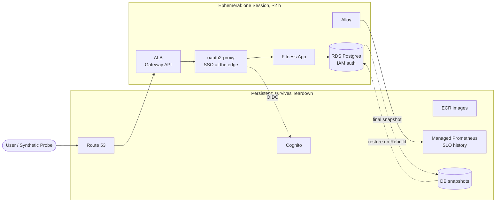

## Architecture

This is a production-style EKS platform that **exists only while I'm working on it**. I rebuild the whole stack from code at the start of every session and tear it down at the end. Each Rebuild doubles as a timed disaster-recovery drill, so recovery time (RTO) and recovery point (RPO) are measured on every run, not estimated.

**Targets:** cost under $30/month · Rebuild (RTO) 30–45 min · RPO 0 on a planned Teardown

### The platform at a glance

### How a Session works

1. **Rebuild:** I trigger a pipeline run that creates the network, the EKS cluster, and the database, restored from the last snapshot.
2. **Sync:** Argo CD deploys everything inside the cluster from Git.
3. **Probe:** A Synthetic Probe signs in through Cognito every 10 s and exercises the app. Its first success stops the RTO clock.
4. **Operate:** Every change is a Git commit, including the faults I inject for incident drills.
5. **Teardown:** A final snapshot, then destroy, then a check that nothing billable is left. The Rebuild Log records the timings.

### Key decisions and trade-offs

| Decision | Why | Trade-off I accept |
| --- | --- | --- |
| **Ephemeral by design** | Cost target under $30/month; every Rebuild is a DR drill | 30–45 min Rebuild budget per Session; no uptime outside one |
| **Terraform stops at the cluster; Argo CD owns everything inside** | One owner per resource; rollback is `git revert` | A small handoff layer (L3) passes per-Rebuild values to Git-managed apps |
| **SSO at the edge (oauth2-proxy + Cognito)** | The app never handles credentials; unauthenticated traffic never reaches it | The hosted-UI redirect is outside the sign-in SLI (documented monitoring gap) |
| **The Synthetic Probe is the only SLI source** | Dashboards, alerts, RTO, and error budgets share one definition of "success" | With no real traffic, SLOs cover only the probe's path |
| **RDS with IAM auth, restored every Rebuild** | No database password; RPO 0 on a planned Teardown | Restore adds ~10–20 min to every Rebuild |
| **fck-nat instead of a NAT Gateway** | ~$3/month vs. ~$32 | Single instance; ~5 min failover |
| **Faults injected as Git changes** | Repeatable, re-testable, recovered by revert | No chaos framework, so no latency or packet-loss faults in v1 |
| **Graviton Spot nodes** | Lowest cost per hour | Every image must be built for arm64 |

*Deliberately left out:* service mesh, multiple environments or accounts, Karpenter, EKS Auto Mode. Each has an entry in the [ADR index](docs/adr/).

### Five layers, one direction

| Layer | Contents | On Teardown |
| --- | --- | --- |
| L0 Bootstrap | State, CI roles, budgets | Kept |
| L1 Persistent | Identity, images, secrets, metrics | Kept |
| L2 Ephemeral core | VPC, EKS, RDS | Destroyed |
| L3 GitOps handoff | Argo CD | Destroyed |
| L4 In-cluster | Everything else, from Git | Destroyed |

Each layer reads only from the layers below it. Teardown removes L4 down to L2 in order and never touches L0 or L1. That one rule is what makes a full daily Teardown safe.

### Where to look next

- [Rebuild Log](docs/rebuild-log.md): RTO and RPO for every drill, plus the trend
- [Postmortems](docs/postmortems/): the 3 injected incidents, each linked to its fix PR and re-test
- [Packet path](docs/writeups/packet-path.md): one request traced from DNS to the pod
- [Architecture spine](docs/architecture-spine.md): the full rule set the platform is built against
